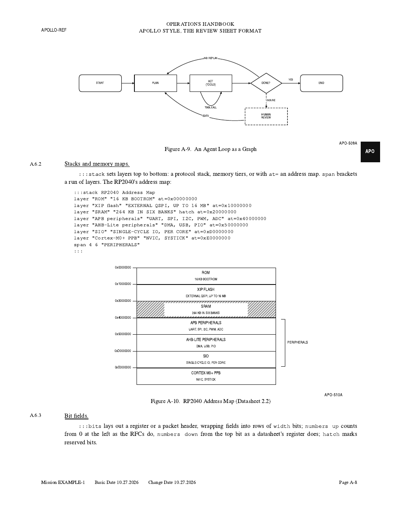
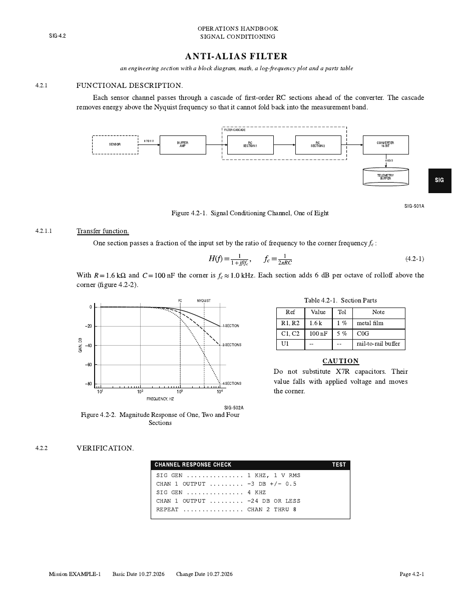
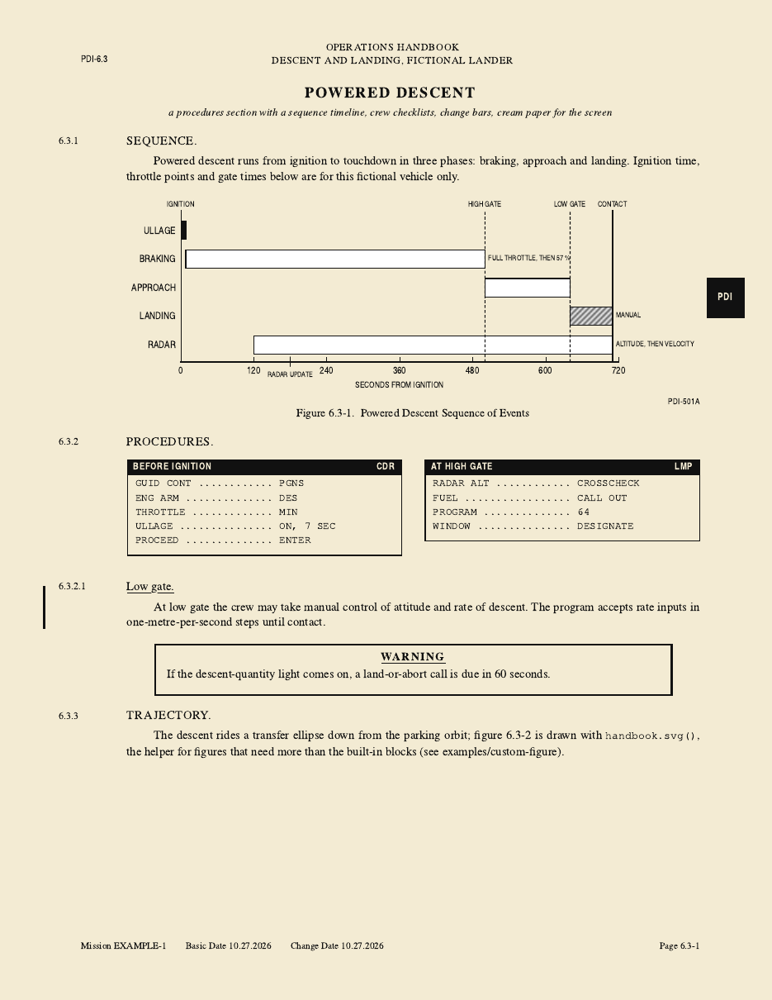

# apollo-sheets

Markdown in, print-ready review sheets out, after the Apollo Operations Handbook: numbered paragraphs in the
gutter, "Figure 2.1-1." captions, drawing numbers, ruled tables, cautions and warnings, checklist panels, change
bars and a black edge tab. US Letter, black ink, made to be printed and read with a pen.

Any plain Markdown report renders as it is. Front matter and a few `:::` blocks add the handbook furniture,
including line-art block diagrams and graphs, timelines, plots, memory maps, bit fields, bar charts, comparison
matrices and heatmaps, trees, labelled pictures, scatter plots, distributions, sankeys, treemaps, quadrants, Venn
diagrams and funnels, all drawn from text.

| | | |
|---|---|---|
|  |  |  |
| [apollo](examples/apollo/apollo.md): the reference sheet, every block beside its source | [rc-filter](examples/rc-filter/rc-filter.md): diagram, math, log plot | [lander](examples/lander/lander.md): timeline, checklists, cream paper |

Start a new sheet from [template.md](template.md). [kitchen-sink](examples/kitchen-sink/kitchen-sink.md) and
[custom-figure](examples/custom-figure/custom-figure.md) are smaller specimens.

## Requirements

- Python 3.8+, `matplotlib`, `numpy`, `pyyaml`
- Google Chrome or Chromium (headless, prints the PDF)
- the URW base35 fonts (Debian/Ubuntu: `apt install fonts-urw-base35`)
- `pdftoppm` (poppler-utils), only for `--png`

Two environment variables cover other machines:

| variable | default |
|---|---|
| `SHEET_FONTS` | `/usr/share/fonts/opentype/urw-base35` |
| `SHEET_CHROME` | `google-chrome` (e.g. `chromium`) |

## Usage

```
python sheet.py report.md                      # writes report.pdf beside it
python sheet.py report.md -o out.pdf --png     # and page PNGs, for a look without a printer
python sheet.py notes.md -s section=3 -s tab=PHY   # someone else's report, as it is
python sheet.py report.md --html               # keep the intermediate HTML
```

## Front matter

```yaml
---
title: Attitude control       # the section's name, set in capitals
section: "2.1"                # paragraph and figure numbers hang off this
tab: ACS                      # edge tab; drawing numbers run ACS-501A, ACS-502A ...
handbook: Operations Handbook # first header line
system: Guidance and control  # second header line
doc: ACS-2.1                  # top left
mission: EXAMPLE-1            # footer fields
date: 10.27.2026              # MM.DD.YYYY; ISO is accepted
change: 10.27.2026            # optional
by: review sheet, from the team notes   # optional, under the title
paper: cream                  # optional: cream for the screen; default white, for printing
---
```

Quote values that contain a colon.

## Blocks

| Markdown | renders as |
|---|---|
| `## Heading` | `2.1.1  HEADING.` numbered in the gutter |
| `### Heading` | `2.1.1.1  Heading.` underlined |
| `# Heading` | a part heading, on a new page |
| `{width=half}` | a numbered figure; `width=third` too; `gray=1` prints a dark screen capture in black ink |
| `$inline$`, `$$display$$`, `\boxed{}` | TeX through matplotlib mathtext; displays are numbered |
| `:::equations` | aligned equations, one a line; a line starting with a relation continues the one above |
| `:::symbols` | the "where" list under an equation: `SYMBOL \| MEANING \| UNIT` |
| `<!-- ... -->` | a comment that never prints |
| `:::table Caption` | wraps a pipe table: numbered and titled |
| `:::note` / `:::caution` / `:::warning` | the three call-outs |
| `:::checklist TITLE \| ROLE` | a boxed procedure in typewriter |
| `:::changed` | change bar in the gutter |
| `::::row` ... `\|\|\|` ... `::::` | side-by-side columns |
| `:::diagram Caption` | block diagram or graph: boxes, diamonds, curved back-edges, loops, `ends=1:N` for ER |
| `:::timeline Caption` | bars on one time axis |
| `:::plot Caption` | lines from a CSV, or exact curves from `fn`; `area` and `percent` bands; `panel` stacks panels on one x |
| `:::sequence Caption` | messages between actors |
| `:::signals Caption` | a timing diagram |
| `:::budget Caption` | used against capacity, one gauge a line |
| `:::stack Caption` | layers top to bottom: a protocol stack, a memory map with `at=` addresses |
| `:::bits Caption` | register or packet fields, wrapped into rows of bits |
| `:::bars Caption` | categorical bars: grouped, `stacked`, `percent`, `horizontal`, `log` |
| `:::matrix Caption` | a comparison: `yes` / `part` / `no` dots, numbers as sized dots; `shade` for a heatmap |
| `:::tree Caption` | a hierarchy from an indented outline |
| `:::callouts Caption` | leaders from points on a PNG to lettering in its margins |
| `:::scatter Caption` | points and bubbles, from lines or a CSV; `fit` draws the least-squares line |
| `:::dist Caption` | box plots from five numbers or raw CSV values, `violin`, or a `hist` |
| `:::sankey Caption` | flows between stages, ribbons as wide as their values |
| `:::treemap Caption` | nested shares from an indented outline |
| `:::quadrant Caption` | a named 2 by 2 with points on it |
| `:::venn Caption` | two or three overlapping sets, regions lettered |
| `:::funnel Caption` | narrowing stages, each with its share of the first |

A block that holds blocks takes four colons: `::::changed` around an `:::equations`, like `::::row`. A block
that never closes, a missing image or a figure spec that does not parse stops the render with a message naming
the block.

The full syntax of every figure block, with each one drawn beside its source, is the reference sheet
[examples/apollo/apollo.md](examples/apollo/apollo.md) ([PDF](examples/apollo/apollo.pdf)). The summaries below
cover the first three and the scatter syntax; section A.8 of the reference sheet is a table for choosing a figure.

Inline: `**bold**`, `*italic*`, `_underline_`, `` `code` ``, `H~2~O`, `10^6^`, ` -- ` for an en dash. Links
keep their words and drop the URL.

### diagram

```
grid 1.7 0.8                              # inches between columns and rows (optional)
node ID "LABEL" COL ROW [box|round|drum|dash|diamond|text] [w=COLS] [h=ROWS]
edge FROM TO ["LABEL"] [dash] [both]
edge FROM TO ["LABEL"] bend=R             # a curve: R > 0 bows right of the way it runs, < 0 left
edge FROM TO ["LABEL"] ends=1:N           # lettering at each end: ER cardinality, 1:1 1:N N:M
loop ID ["LABEL"] [top|bottom]            # an edge from a node back to itself
fence "LABEL" ID ID ...                   # dashed boundary round a subsystem
note COL ROW "TEXT"                       # small free lettering
```

Edges route orthogonally round the other boxes: straight, one elbow either way, or a Z through the gap between
rows or columns. A `diamond` is a decision; `bend=R` is for back-edges and cycles. `\n` breaks a label.

### timeline

```
axis "LABEL" START END [ticks=STEP]
bar "ROW" START END [hatch|open|solid] ["NOTE"]
mark AT "LABEL" [dash]
call ROW AT "TEXT"                        # leader from a bar to lettering below the axis
```

### plot

```
csv data.csv                              # relative to the sheet
x COLUMN ["LABEL"]
y COLUMN ["LABEL"] [dots|step|area] [every=N]   # one per line, labelled at its right end; area stacks bands
percent                                   # the area bands as shares of their sum
range LO HI                               # x range for fn curves
fn "EXPR" ["LABEL"]                       # an expression in x, drawn exactly: arithmetic and numpy functions
                                          # (sin exp sqrt log10 pi where degrees radians ...), nothing else
xlabel / ylabel "LABEL"
log x|y|xy
xlim / ylim LO HI
size wide | size W H
mark AT "LABEL"
hline AT "LABEL"
panel                                     # another panel below, on the same x; the y lines after it go there
```

### scatter

```
point X Y ["LABEL"] [size=N]              # one point a line; size= makes it a bubble
csv data.csv X Y [size=COL] [label=COL]   # points from columns of a CSV instead
xlabel / ylabel "LABEL"
log x|y|xy
fit                                       # least-squares line and its r, on the axes as drawn
size W H
```

### your own figures

Draw in matplotlib under `handbook.STYLE` and save with `handbook.svg(fig)`; see
[examples/custom-figure](examples/custom-figure/orbit.py).

## As a Claude skill

Clone into your skills directory and the agent can turn any report into a sheet:

```
git clone https://github.com/hed0rah/apollo-sheets ~/.claude/skills/apollo-sheets
```

## Credits

The look is an homage to the Apollo Operations Handbooks (public domain, NASA). This project is not affiliated
with or endorsed by NASA.

MIT license.
