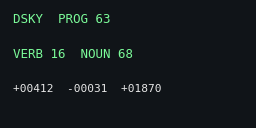

## Functional description

A review sheet is a section of a handbook made from one agent's report: numbered paragraphs, figures and tables
with drawing numbers, call-outs, checklists and equations, printed in black on US Letter to be read with a pen.
The report is plain Markdown; `sheet.py` renders it as it is, and the `:::` blocks below add the handbook furniture.
Figures are drawn by `handbook.py` as line art with live lettering, equations by matplotlib's mathtext, and the page
by headless Chrome from HTML and `sheet.css`.

:::diagram Review Sheet Functional Diagram
grid 1.45 0.8
node fm "FRONT MATTER\n-s KEY=VALUE" 1 0 dash
node mt "MATHTEXT\nEQUATIONS" 2 0
node rep "AGENT REPORT\n(MARKDOWN)" 0 1 round
node sheet "SHEET.PY" 1 1
node html "HTML\n+ SHEET.CSS" 2 1
node chrome "HEADLESS\nCHROME" 3 1
node pdf "SHEET PDF\n(US LETTER)" 4 1 round
node hb "HANDBOOK.PY\nFIGURES" 2 2
node fonts "URW BASE35\nFONTS" 3 2 drum
node png "PAGE PNGS\n(--PNG)" 4 2 dash
edge rep sheet
edge fm sheet
edge sheet html
edge mt html "SVG"
edge hb html "SVG"
edge html chrome
edge fonts chrome
edge chrome pdf
edge pdf png "PDFTOPPM"
:::

```
python sheet.py report.md                         writes report.pdf beside it
python sheet.py report.md -o out.pdf --png        and page PNGs, to look without a printer
python sheet.py notes.md -s section=3 -s tab=PHY  someone else's report, without editing it
```

## Page design

:::table Design Rules
| Element | Set in | Rule |
|---|---|---|
| Body | Nimbus Roman 9.6 pt on 1.32 | justified and hyphenated; the first line after a heading indented 0.3 in |
| Lettering on figures | Nimbus Sans Narrow, 5 to 7 pt | capitals only; the same face live in the PDF, never outlines |
| Checklists, code | Nimbus Mono PS 8.3 pt | a checklist is boxed, under a black bar carrying its title and role |
| Page | US Letter | margins 0.95 in top, 0.85 bottom, 0.45 left, 0.3 right; a 0.95 in gutter for numbers |
| Ink | black only | white paper to print; `paper: cream` for a screen copy |
| Headings | `##` capitals, `###` underlined | the paragraph number hangs in the gutter: A.4, A.4.2 |
| Numbers | Figure A-1, Table A-1, (A-1) | figures and tables count through the section; table titles above, captions below |
| Drawing numbers | APO-501A ... | one per figure, bottom right, from the tab |
| Strokes | 0.6 to 0.9 pt | dashed for optional or planned, hatched for used or selected, solid black for on |
| Series | dash pattern, end label | solid, dashed, dotted, dash-dot; labelled at the line's end, never by colour or legend |
| Header, footer | doc, handbook, system; mission, dates, page | dates MM.DD.YYYY; page A-n from the section |
| Changes | bar in the gutter | `:::changed` beside anything altered after the basic date; set `change:` |
:::

The page is quiet on purpose: no colour, no shading but hatch, no rules but the table frames and the `---` line.
Anything that needs colour to be read needs redrawing, not colouring; a colour screen capture prints inverted to
ink with `gray=1`.

## Text and call-outs

### Headings and paragraphs
A `#` heading names the sheet when there is no `title`; a later `#` starts a part on a new page. `##`, `###` and
`####` are numbered from `section`, and any number the report gave its own headings is dropped. Inline marks:
`**bold**`, `*italic*`, `_underline_`, backticks for code, `^sup^`, `~sub~`, `$math$`, and ` -- ` for a dash. Links
keep their words; paper has no links. A line starting `<!--` opens a comment that never prints, up to `-->`.

### Call-outs and checklists

::::row
```
:::caution
Text that, if ignored, costs
time or data.
:::

:::warning
Text that, if ignored, damages
hardware or loses work for good.
:::

:::note
Anything worth a box that is
neither.
:::
```
|||
:::caution
Text that, if ignored, costs time or data.
:::

:::warning
Text that, if ignored, damages hardware or loses work for good.
:::

:::note
Anything worth a box that is neither.
:::
::::

::::row
```
:::checklist Render a Sheet | Any
1  python sheet.py r.md --png
2  read every page PNG
3  fix, render again
:::

:::changed
A paragraph altered after the
basic date.
:::
```
|||
:::checklist Render a Sheet | Any
1  python sheet.py r.md --png
2  read every page PNG
3  fix, render again
:::

:::changed
A paragraph altered after the basic date. The bar is in the gutter, beside the paragraph number.
:::
::::

## Mathematics

### Inline and display
Inline math sits on the baseline of the text: the corner of an RC low-pass is $f_c = 1/(2\pi R C)$, written
`$f_c = 1/(2\pi R C)$`. A display, `$$ ... $$` on its own lines, is centred and numbered from the section:

$$ |H(f)| = \frac{1}{\sqrt{1 + (f/f_c)^{2n}}} $$

:::symbols
f | frequency | Hz
f_c | corner frequency, where the gain is down 3 dB | Hz
n | order of the Butterworth filter |
:::

The `:::symbols` block above is the handbook's "where" list: one `SYMBOL | MEANING | UNIT` a line, the symbol in
TeX without dollars.

### Aligned equations
`:::equations` sets one equation a line, aligned on its first relation (or on `&` where a line has one). A line that
starts with a relation continues the one above and takes no number. Here, the length of an audio block:

::::row
```
:::equations
T_{\mathrm{block}} = N / f_s
= 128 / 44100\ \mathrm{s}
\approx 2.902\ \mathrm{ms}
G_{\mathrm{dB}}(f_c) = {-10} \log_{10} 2
\approx {-3.01}\ \mathrm{dB}
:::
```
|||
:::equations
T_{\mathrm{block}} = N / f_s
= 128 / 44100\ \mathrm{s}
\approx 2.902\ \mathrm{ms}
G_{\mathrm{dB}}(f_c) = {-10} \log_{10} 2
\approx {-3.01}\ \mathrm{dB}
:::
::::

### A result, boxed
`$$\boxed{...}$$` frames the line a reader should carry away:

$$ \boxed{f_c = \frac{1}{2 \pi R C}} $$

:::caution
Equations are set by matplotlib's mathtext, a subset of TeX: fractions, roots, sub- and superscripts, Greek,
`\left( \right)`, accents, `\mathrm`, `\mathbf`, `\mathcal`, sums and integrals. It has no environments
(`\begin{aligned}`, matrices, `cases`): use `:::equations` for alignment, a table for a matrix. `\text{}` is
rewritten to `\mathrm{}` and `\sqrt x` to `\sqrt{x}`. What will not parse prints as its TeX in typewriter, so
nothing is lost: $\begin{pmatrix} a & b \end{pmatrix}$.
:::

## Figures

Every figure is line art with a caption below and a drawing number at its lower right. `:::diagram`,
`:::timeline`, `:::sequence`, `:::signals` and `:::budget` run the width of the column; a `:::plot` is 3.4 by
2.2 in unless it says `size wide` or `size W H`, so two sit side by side in a `::::row`.

### Plots: exact functions and tabulated series
`fn "EXPR"` draws a curve exactly from a numpy expression in `x` (`sin exp sqrt log10 pi where clip` and the
like), over `range LO HI`. `y COLUMN` draws a column of a CSV against `x COLUMN`; `dots` sets it as points, the way
measurements are told from a model. Thresholds are `hline`, events `mark`.

::::row
```
:::plot Butterworth Gain re the Corner
range 0.01 10
fn "-10*log10(1+x**2)" "N = 1"
fn "-10*log10(1+x**4)" "N = 2"
fn "-10*log10(1+x**8)" "N = 4"
log x
xlabel "f / fc"
ylabel "gain, dB"
ylim -85 5
hline -3.01 "-3 DB"
mark 1 "CORNER"
:::
```
|||
:::plot Butterworth Gain re the Corner
range 0.01 10
fn "-10*log10(1+x**2)" "N = 1"
fn "-10*log10(1+x**4)" "N = 2"
fn "-10*log10(1+x**8)" "N = 4"
log x
xlabel "f / fc"
ylabel "gain, dB"
ylim -85 5
hline -3.01 "-3 DB"
mark 1 "CORNER"
:::
::::

::::row
```
:::plot Echo Density, 4 m Cube
csv density.csv
x ms "ms after the click"
y d3 "" dots every=6
fn "4*pi*343**3*(x/1000)**2/4**3" "3D"
log xy
ylabel "echoes per second"
hline 48000 "ONE PER SAMPLE"
:::
```
The dots are a CSV of counts; the line is
$4\pi c^3 t^2 / V$ for $c$ = 343 m/s and
$V$ = 64 m^3^, drawn over the CSV's own x.
|||
:::plot Echo Density, 4 m Cube: CSV (Dots) and Formula (Line)
csv density.csv
x ms "ms after the click"
y d3 "" dots every=6
fn "4*pi*343**3*(x/1000)**2/4**3" "3D"
log xy
ylabel "echoes per second"
hline 48000 "ONE PER SAMPLE"
:::
::::

### Block diagrams
Figure A-1 is a `:::diagram`. Nodes sit on a grid of columns and rows (`grid DX DY` in inches, if the default
1.55 by 0.78 crowds the lettering); edges route themselves straight, with one elbow, or with a Z through the gap between rows or
columns, whichever clears the other boxes, and are labelled on their longest run. Shapes: `box`, `round` for ends, `dash` for the optional, `drum` for storage, `text` for bare lettering;
`fence "LABEL" ids...` draws a dashed subsystem boundary.

```
:::diagram Review Sheet Functional Diagram
grid 1.45 0.8
node fm "FRONT MATTER\n-s KEY=VALUE" 1 0 dash
node rep "AGENT REPORT\n(MARKDOWN)" 0 1 round
node sheet "SHEET.PY" 1 1
node fonts "URW BASE35\nFONTS" 3 2 drum
edge rep sheet
edge mt html "SVG"
edge pdf png "PDFTOPPM"
...
:::
```

### Timelines
Rows of bars on one axis, `hatch`, `open` or `solid`; `mark` for a moment across every row, `call` for a leader
to lettering below the axis. Apollo 11, from launch:

```
:::timeline Apollo 11, Ground Elapsed Time
axis "ground elapsed time, hours" 0 200 ticks=25
bar "Earth orbit" 0 2.74 solid
bar "Translunar coast" 2.74 75.83 open
bar "Lunar orbit (CSM)" 75.83 135.40 hatch
bar "LM on the surface" 102.76 124.37 hatch
bar "EVA" 109.13 111.65 solid
bar "Transearth coast" 135.40 195.31 open
mark 102.76 "LANDING" dash
mark 195.31 "SPLASHDOWN" dash
:::
```

:::timeline Apollo 11, Ground Elapsed Time (Launch 07.16.1969, 13:32 UTC)
axis "ground elapsed time, hours" 0 200 ticks=25
bar "Earth orbit" 0 2.74 solid
bar "Translunar coast" 2.74 75.83 open
bar "Lunar orbit (CSM)" 75.83 135.40 hatch
bar "LM on the surface" 102.76 124.37 hatch
bar "EVA" 109.13 111.65 solid
bar "Transearth coast" 135.40 195.31 open
mark 102.76 "LANDING" dash
mark 195.31 "SPLASHDOWN" dash
:::

### Sequence charts
Messages between actors, one step a line, top to bottom: protocols, install flows, a review's hand-offs. `dash`
for a reply, the same actor twice for its own work, `gap` where time passes. A review's hand-offs:

```
:::sequence A Review's Hand-offs
actor agent "REPORTING\nAGENT"
actor writer "SHEET\nWRITER"
actor check "FACT\nCHECKER"
actor owner "OWNER"
msg agent writer "REPORT, SOURCES"
msg writer writer "RENDER, DRAW"
msg writer check "DRAFT PDF"
msg check writer "CORRECTIONS" dash
msg writer owner "FINAL PDF"
gap "LATER"
msg owner writer "A CHANGE" dash
note writer "CHANGE BAR\nCHANGE DATE"
msg writer owner "CHANGED PDF"
:::
```

:::sequence A Review's Hand-offs
actor agent "REPORTING\nAGENT"
actor writer "SHEET\nWRITER"
actor check "FACT\nCHECKER"
actor owner "OWNER"
msg agent writer "REPORT, SOURCES"
msg writer writer "RENDER, DRAW"
msg writer check "DRAFT PDF"
msg check writer "CORRECTIONS" dash
msg writer owner "FINAL PDF"
gap "LATER"
msg owner writer "A CHANGE" dash
note writer "CHANGE BAR\nCHANGE DATE"
msg writer owner "CHANGED PDF"
:::

### Timing diagrams
`:::signals` draws lines and buses on one step axis, a character a step: `0 1` levels, `p n` a clock period
starting high or low, `.` hold, `z` released, `x` unknown, `=` a bus value lettered from a list. An SPI flash
taking the JEDEC read-ID command 0x9F in mode 0, shifted on the falling edge and sampled on the rising:

```
:::signals SPI Mode 0, Command 0x9F (Read JEDEC ID)
signal "CS#" 1000000001
signal "SCLK" 0nnnnnnnn0
signal "MOSI" x========x "1,0,0,1,1,1,1,1"
signal "MISO" zzzzzzzzzz
mark 1 "CS# LOW, BIT 7 OUT"
mark 1.5 "SAMPLED" dash
mark 9 "CS# HIGH"
:::
```

:::signals SPI Mode 0, Command 0x9F (Read JEDEC ID)
signal "CS#" 1000000001
signal "SCLK" 0nnnnnnnn0
signal "MOSI" x========x "1,0,0,1,1,1,1,1"
signal "MISO" zzzzzzzzzz
mark 1 "CS# LOW, BIT 7 OUT"
mark 1.5 "SAMPLED" dash
mark 9 "CS# HIGH"
:::

### Budget gauges
Used against capacity, one gauge a line, hatched to the used fraction, with the figures and the percentage at the
end; hex is read as hex. `mark PERCENT "LABEL"` sets a limit across them all. A firmware image's memory:

```
:::budget Firmware 1.0 Memory
bar "RAM, static" 61200 73728 B
bar "Heap region" 301000 368640 B
bar "App image in flash slot" 412000 0x80000 B
bar "Bootloader" 9800 0x4000 B
:::
```

:::budget Firmware 1.0 Memory
bar "RAM, static" 61200 73728 B
bar "Heap region" 301000 368640 B
bar "App image in flash slot" 412000 0x80000 B
bar "Bootloader" 9800 0x4000 B
:::

### Pictures and columns
`{width=half}` takes an SVG, inlined so its lettering stays live, or a PNG; `width=third` and
`gray=1` (a dark screen capture, printed inverted as ink on paper) are the options. `::::row` sets its contents
side by side, columns split on a line `|||`, closed by `::::`; anything can go in a column.

::::row
```
{width=third gray=1}
```
|||
{width=third gray=1}
::::

## More figures

### Graphs: decisions, back-edges and loops
`:::diagram` draws graphs as well as block diagrams: a `diamond` node for a decision, `bend=R` on an edge for a
curve (a back-edge to an earlier step; R above 0 bows right of the way it runs, below 0 left), and `loop ID` for a
node that goes back to itself. An agent's loop, the shape of a LangGraph graph:

```
:::diagram An Agent Loop as a Graph
grid 1.5 0.9
node start "START" 0 0 round
node plan "PLAN" 1 0
node act "ACT\n(TOOLS)" 2 0
node check "DONE?" 3 0 diamond w=0.8 h=1.1
node end "END" 4 0 round
node human "HUMAN\nREVIEW" 3 1 dash
edge start plan
edge plan act
edge act check
edge check end "YES"
edge check plan "NO: REPLAN" bend=0.45
edge check human "UNSURE" dash
edge human plan "EDITS" bend=-0.3
loop act "TOOL CALL" bottom
:::
```

:::diagram An Agent Loop as a Graph
grid 1.5 0.9
node start "START" 0 0 round
node plan "PLAN" 1 0
node act "ACT\n(TOOLS)" 2 0
node check "DONE?" 3 0 diamond w=0.8 h=1.1
node end "END" 4 0 round
node human "HUMAN\nREVIEW" 3 1 dash
edge start plan
edge plan act
edge act check
edge check end "YES"
edge check plan "NO: REPLAN" bend=0.45
edge check human "UNSURE" dash
edge human plan "EDITS" bend=-0.3
loop act "TOOL CALL" bottom
:::

### Stacks and memory maps
`:::stack` sets layers top to bottom: a protocol stack, memory tiers, or with `at=` an address map. `span` brackets
a run of layers. The RP2040's address map:

```
:::stack RP2040 Address Map
layer "ROM" "16 KB BOOTROM" at=0x00000000
layer "XIP flash" "EXTERNAL QSPI, UP TO 16 MB" at=0x10000000
layer "SRAM" "264 KB IN SIX BANKS" hatch at=0x20000000
layer "APB peripherals" "UART, SPI, I2C, PWM, ADC" at=0x40000000
layer "AHB-Lite peripherals" "DMA, USB, PIO" at=0x50000000
layer "SIO" "SINGLE-CYCLE IO, PER CORE" at=0xD0000000
layer "Cortex-M0+ PPB" "NVIC, SYSTICK" at=0xE0000000
span 4 6 "PERIPHERALS"
:::
```

:::stack RP2040 Address Map (Datasheet 2.2)
layer "ROM" "16 KB BOOTROM" at=0x00000000
layer "XIP flash" "EXTERNAL QSPI, UP TO 16 MB" at=0x10000000
layer "SRAM" "264 KB IN SIX BANKS" hatch at=0x20000000
layer "APB peripherals" "UART, SPI, I2C, PWM, ADC" at=0x40000000
layer "AHB-Lite peripherals" "DMA, USB, PIO" at=0x50000000
layer "SIO" "SINGLE-CYCLE IO, PER CORE" at=0xD0000000
layer "Cortex-M0+ PPB" "NVIC, SYSTICK" at=0xE0000000
span 4 6 "PERIPHERALS"
:::

### Bit fields
`:::bits` lays out a register or a packet header, wrapping fields into rows of `width` bits; `numbers up` counts
from 0 at the left as the RFCs do, `numbers down` from the top bit as a datasheet's register does; `hatch` marks
reserved bits.

```
:::bits IPv4 Header
numbers up
field "Version" 4
field "IHL" 4
field "DSCP" 6
field "ECN" 2
field "Total length" 16
field "Identification" 16
field "Flags" 3
field "Fragment offset" 13
field "TTL" 8
field "Protocol" 8
field "Header checksum" 16
field "Source address" 32
field "Destination address" 32
:::
```

:::bits IPv4 Header (RFC 791; DSCP and ECN from RFCs 2474 and 3168)
numbers up
field "Version" 4
field "IHL" 4
field "DSCP" 6
field "ECN" 2
field "Total length" 16
field "Identification" 16
field "Flags" 3
field "Fragment offset" 13
field "TTL" 8
field "Protocol" 8
field "Header checksum" 16
field "Source address" 32
field "Destination address" 32
:::

### Bars
`:::bars` compares categories: one value a series, series side by side or `stacked`, told apart by hatch with a
key above only when there is more than one; `horizontal` for long names, `log` for spans of decades. Values print
at the bar ends.

::::row
```
:::bars On-Chip SRAM
horizontal
log
unit "KB"
bar "ATmega328P" 2
bar "STM32F103C8" 20
bar "RP2040" 264
bar "ESP32" 520
bar "RP2350" 520
:::
```
|||
:::bars On-Chip SRAM, KB
horizontal
log
unit "KB"
bar "ATmega328P" 2
bar "STM32F103C8" 20
bar "RP2040" 264
bar "ESP32" 520
bar "RP2350" 520
:::
::::

::::row
```
:::bars Time to Render a Sheet
series "Python" "Chrome"
stacked
unit "seconds"
bar "Service A" 0.38 0.65
bar "Firmware B" 0.22 0.86
bar "Template" 0.24 0.59
:::
```
Measured 10.28.2026, the best of three runs: Python is `render()`, Chrome the print to PDF.
|||
:::bars Time to Render a Sheet, Seconds
series "Python" "Chrome"
stacked
unit "seconds"
bar "Service A" 0.38 0.65
bar "Firmware B" 0.22 0.86
bar "Template" 0.24 0.59
:::
::::

### Matrices
`:::matrix` compares at a glance: `yes`, `part` and `no` print as a full, half and open dot, `-` as a dash, a number
as a dot of that area, anything else as lettering.

```
:::matrix Five Microcontrollers
cols "Wi-Fi" "Bluetooth LE" "USB host and device" "Hardware FPU" "Two cores"
row "ATmega328P" no no no no no
row "STM32F103C8" no no part no no
row "RP2040" no no yes no yes
row "ESP32" yes yes no yes yes
row "RP2350" no no yes yes yes
:::
```

:::matrix Five Microcontrollers (Half Dot: the STM32F103's USB Is Device Only)
cols "Wi-Fi" "Bluetooth LE" "USB host and device" "Hardware FPU" "Two cores"
row "ATmega328P" no no no no no
row "STM32F103C8" no no part no no
row "RP2040" no no yes no yes
row "ESP32" yes yes no yes yes
row "RP2350" no no yes yes yes
:::

### Trees
`:::tree` draws a hierarchy from an indented outline, two spaces a level, the root at the left (`down` on the first
line puts it at the top). Who owns what in a Kubernetes Deployment:

```
:::tree Kubernetes Ownership
Deployment
  ReplicaSet\n(current)
    Pod
    Pod
    Pod
  ReplicaSet\n(previous, 0) [dash]
:::
```

:::tree A Deployment's Ownership Chain
Deployment
  ReplicaSet\n(current)
    Pod
    Pod
    Pod
  ReplicaSet\n(previous, 0) [dash]
:::

### Panels
A `panel` line in a `:::plot` starts another panel under the first, on the same x: a Bode plot's magnitude and phase,
here a first-order low-pass:

::::row
```
:::plot First-Order Low-Pass
range 0.01 100
log x
fn "-10*log10(1+x**2)"
ylabel "gain, dB"
hline -3.01 "-3 DB"
mark 1 "CORNER"
panel
fn "-degrees(arctan(x))"
ylabel "phase, deg"
ylim -95 5
hline -45 "-45 DEG"
xlabel "f / fc"
:::
```
|||
:::plot First-Order Low-Pass, Gain and Phase
range 0.01 100
log x
fn "-10*log10(1+x**2)"
ylabel "gain, dB"
hline -3.01 "-3 DB"
mark 1 "CORNER"
panel
fn "-degrees(arctan(x))"
ylabel "phase, deg"
ylim -95 5
hline -45 "-45 DEG"
xlabel "f / fc"
:::
::::

### Callouts
`:::callouts` names the parts of a picture: a leader from each point (fractions of the picture from its top left)
to lettering in the margin on the nearer side. `gray` inverts a dark screen to ink.

```
:::callouts A Display Capture
image ../kitchen-sink/screen.png gray
at 0.33 0.22 "program number"
at 0.15 0.52 "verb: what to do"
at 0.53 0.45 "noun: what to do it to"
at 0.03 0.69 "register 1"
at 0.36 0.78 "register 2"
at 0.64 0.69 "register 3"
:::
```

:::callouts A Display Capture, Named
image ../kitchen-sink/screen.png gray
at 0.33 0.22 "program number"
at 0.15 0.52 "verb: what to do"
at 0.53 0.45 "noun: what to do it to"
at 0.03 0.69 "register 1"
at 0.36 0.78 "register 2"
at 0.64 0.69 "register 3"
:::

## Making a sheet

:::checklist Turn a Report into a Sheet | Writer
1  python sheet.py report.md --png
     -s section=N -s tab=XXX -s date=MM.DD.YYYY
2  read every page PNG; fix what crowds
3  add figures, equations, cautions, checklists
4  byline DRAFT; send to the fact checker
5  apply corrections; name the checker
6  commit; send the PDF
:::

For a sheet of your own, copy `template.md`: it has the front matter and one of each block, with comments
that do not print. Later changes go in `:::changed` with `change:` set in the front matter; the basic date stays.

:::caution
Chrome does not print into the page margins, so the gutter numbers, edge tab and change bars sit inside the
content box: keep `main`'s padding when restyling. A block closes at the first line of exactly its own colons, so a
block that holds blocks takes four (`::::changed` around `:::equations`), and a row's source cannot be shown in a row.
:::
