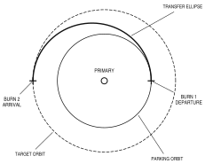

## Sequence

Powered descent runs from ignition to touchdown in three phases: braking, approach and landing. Ignition time,
throttle points and gate times below are for this fictional vehicle only.

:::timeline Powered Descent Sequence of Events
axis "seconds from ignition" 0 720 ticks=120
bar ullage 0 8 solid
bar braking 8 500 open "full throttle, then 57 %"
bar approach 500 640 open
bar landing 640 710 hatch "manual"
bar radar 120 710 open "altitude, then velocity"
mark 0 "IGNITION"
mark 500 "HIGH GATE" dash
mark 640 "LOW GATE" dash
mark 710 "CONTACT"
call radar 180 "radar update"
:::

## Procedures

::::row
:::checklist Before ignition | CDR
GUID CONT ............ PGNS
ENG ARM .............. DES
THROTTLE ............. MIN
ULLAGE ............... ON, 7 SEC
PROCEED .............. ENTER
:::
|||
:::checklist At high gate | LMP
RADAR ALT ............ CROSSCHECK
FUEL ................. CALL OUT
PROGRAM .............. 64
WINDOW ............... DESIGNATE
:::
::::

:::changed
### Low gate

At low gate the crew may take manual control of attitude and rate of descent. The program accepts rate inputs
in one-metre-per-second steps until contact.
:::

:::warning
If the descent-quantity light comes on, a land-or-abort call is due in 60 seconds.
:::

## Trajectory

The descent rides a transfer ellipse down from the parking orbit; figure 6.3-2 is drawn with `handbook.svg()`,
the helper for figures that need more than the built-in blocks (see examples/custom-figure).

{width=half}
